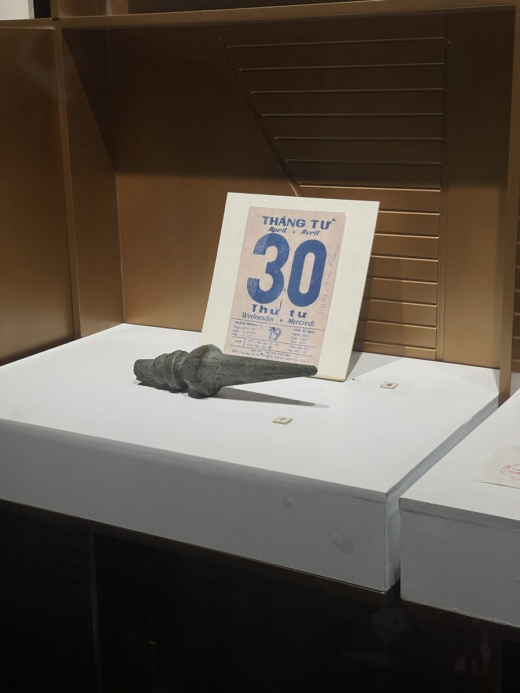
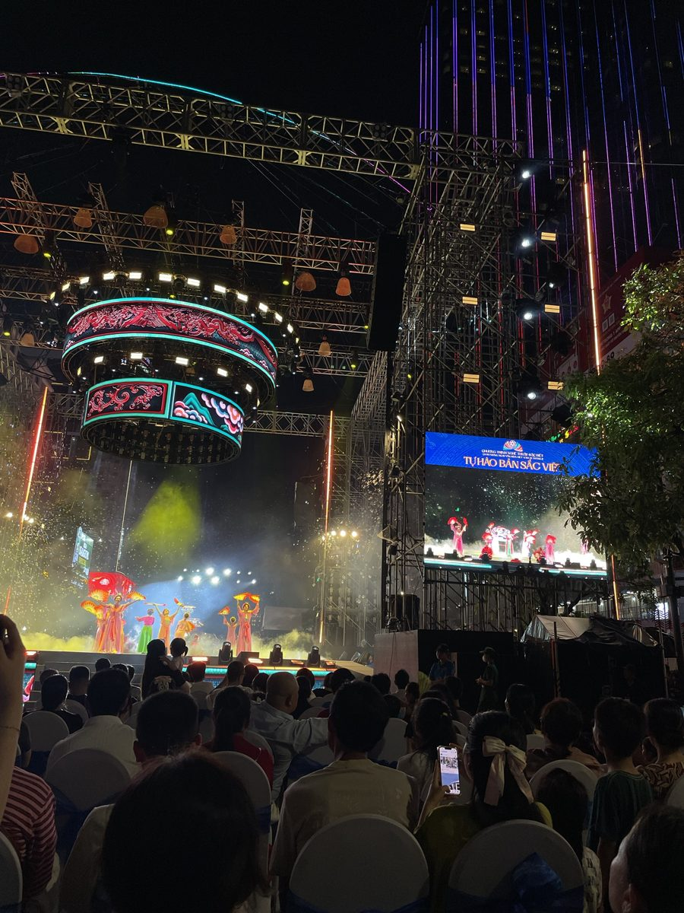
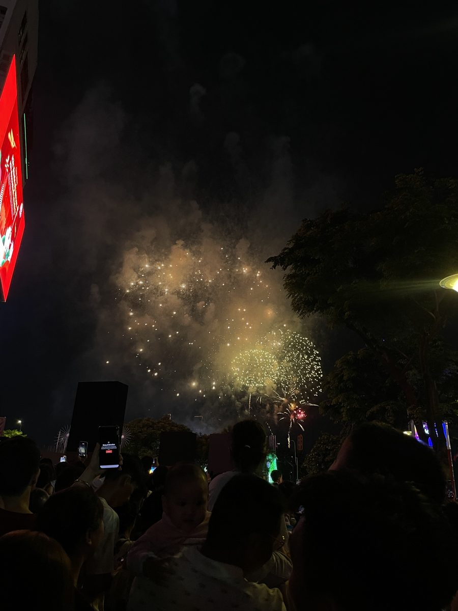
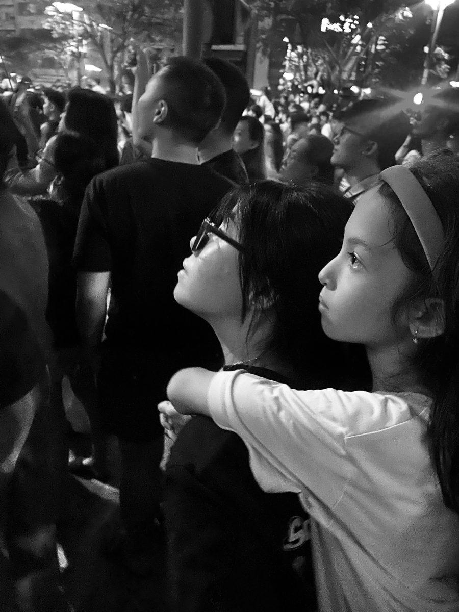

24/11/2026 là ngày đầu tiên Việt Nam đón chào ngày lễ gọi là Ngày Văn hoá Việt Nam.

Cách đây đúng 80 năm, ngày 24/11/1946, Hội nghị Văn hoá toàn quốc lần thứ nhất được tổ chức tại Hà Nội. Lúc bấy giờ, Việt Nam mới giành được độc lập hơn một năm, chính quyền cách mạng còn non trẻ, đất nước đứng trước muôn vàn khó khăn và nguy cơ chiến tranh.

Thậm chí, chỉ 25 ngày sau hội nghị, cuộc Toàn quốc kháng chiến chống thực dân Pháp chính thức bùng nổ.

Trong bối cảnh ấy, Chủ tịch Hồ Chí Minh đã khẳng định một tư tưởng mang ý nghĩa sâu sắc: “Văn hoá phải soi đường cho quốc dân đi”.

Hôm nay mọi người đều sẽ được nghỉ làm như một ngày lễ chính thức được công nhận, Sài Gòn đã rộn ràng từ những hôm trước với nhiều hoạt động văn hoá.

Mãi đến hôm nay khi có dịp đi tham gia workshop ở Bảo tàng Chứng tích Chiến tranh. Dạo qua hết các ngách của bảo tàng để xem từng kỷ vật của cha ông ta ngày xưa để lại từ chiếc nón cối, chiếc lược ngà hay một lá thư tay viết vội gửi cho hậu phương đang ngóng trông ở quê nhà. Cả đám không khỏi xuýt xoa vì những chiếc máy quay, máy chụp cổ mang đậm chất văn hoá xưa. Dõi theo hành trình bảo vệ non sông đất nước mà phải đánh đổi cả mạng sống của mình, khoảnh khắc này khi là một người con của Việt Nam tôi rất biết ơn những người chiến sĩ đã phải nằm lại nơi chiến trường lạnh lẽo để mang đến hoà bình cho đất nước.

Tối đến, cả đám kéo nhau đi dọc trên phố đi bộ thưởng thức những món ăn bình dân nhất, mang văn hoá Việt Nam nhất.

Cũng tại đây, ở thành phố mang tên Bác, cả đám lặng người khi nghe qua những ca khúc mang đậm dấu ấn văn hoá Việt Nam từ Bắc vào Nam, từ Chèo, Lý, những điệu nhảy từ Tây Nguyên cho đến những câu hò ngọt lịm muốn rơi vào giấc ngủ của người dân Miền Tây.

Mỗi giai điệu đều mang một phong cách, một sắc màu riêng nhưng đêm nay nó hoà quyện vào nhau khó tả.

Tôi tự hỏi, những bài hát hay và cổ xưa như thế này phải đợi bao nhiêu năm mới có thể được trình diễn trên một sân khấu lớn và riêng như thế này nếu không có ngày hôm nay?

Là một người trẻ, được sinh ra khi đời sống con người dần hoà vào công nghệ, tôi tin rằng mình là thế hệ cuối cùng vẫn có tuổi thơ nghe lời ru, câu cải lương từ ông bà. Từ lâu tôi đã mong muốn nét văn hoá này sẽ sống mãi nhưng dần lớn lên rồi tôi nhận ra rằng nó đã dần ít đi rồi, liệu một ngày nó có biến mất luôn không?

Kết thúc chương trình bằng một màn trình diễn pháo hoa 15 phút tại bến sông Sài Gòn. Sống ở Sài Gòn cũng đã 4 năm, mình chưa từng nghĩ, một ngày nào đó sẽ chen chúc vào dòng người vội vã để xem pháo hoa. Vậy mà hôm nay tôi đã đứng cùng hàng ngàn người để ngắm khoảnh khắc Sài Gòn khoác lên chiếc áo hoa nhiều màu sắc và rất riêng.

Đang mải mê nhìn những đợt pháo đổi màu, tôi nhìn thấy một bé gái chừng 6 tuổi đang cố vươn mình để xem pháo hoa giữa những người lớn khổng lồ trước mắt. Vì thấy quá là thương bé nên tôi đã cõng bé suốt hơn 10 phút trên vai để em được ngắm nhìn trọn vẹn hơn. Tôi nhìn thấy trong đôi mắt bé gái một sự vô tư, một sự hồn nhiên mà trước đây bản thân mình đã từng có. Trên quãng đường chúng ta lớn lên, nếu như nhiều lần nhận được sự giúp đỡ như vậy, ít nhiều bé gái cũng sẽ trở thành một người sẵn sàng giúp đỡ ai đó mà cũng chẳng mong chờ họ sẽ biết tên.

Bản thân tôi thấy hạnh phúc vì mang lại được hạnh phúc cho người khác, mong cho bé gái lớn lên học thật chăm và luôn nhớ về văn hoá Việt Nam.

Màn pháo hoa mãn nhãn cũng kết thúc, ai ai cũng đi ngược dòng trở về mái nhà của mình, dòng người chen chúc nhau giữa lòng Sài Thành, tấp nập vô cùng.

Ngày Văn hoá Việt Nam năm đầu tiên đã thành công tốt đẹp, một phần chắc chắn là nhờ sự đóng góp, tham gia của toàn thể người Việt Nam yêu nước, cùng nhau đi xa hơn ở kỷ nguyên vươn mình.

Một ngày văn hoá vô cùng ý nghĩa, tôi vô cùng tự hào khi là một người dân Việt Nam.
